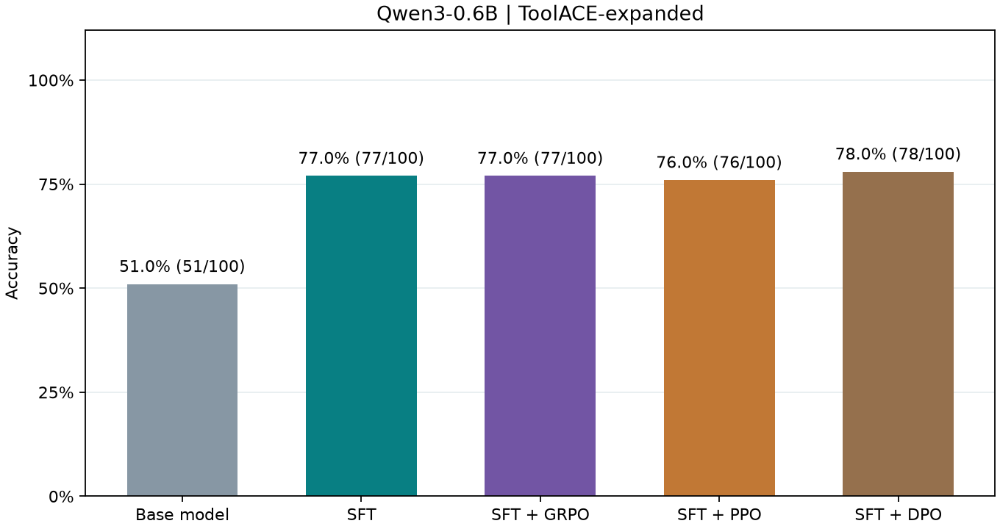
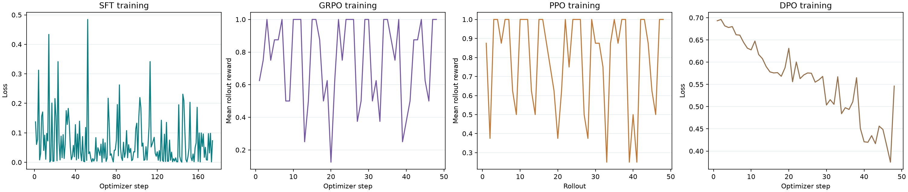
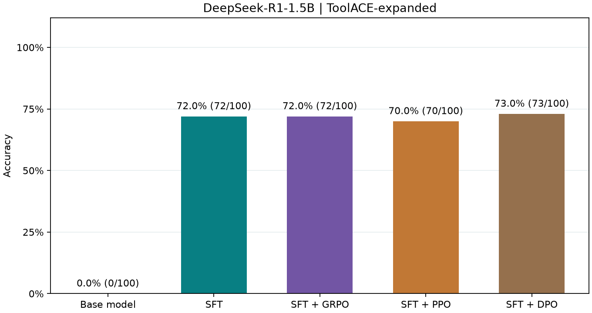
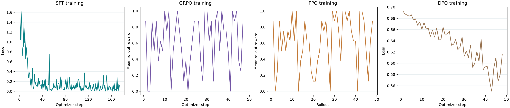
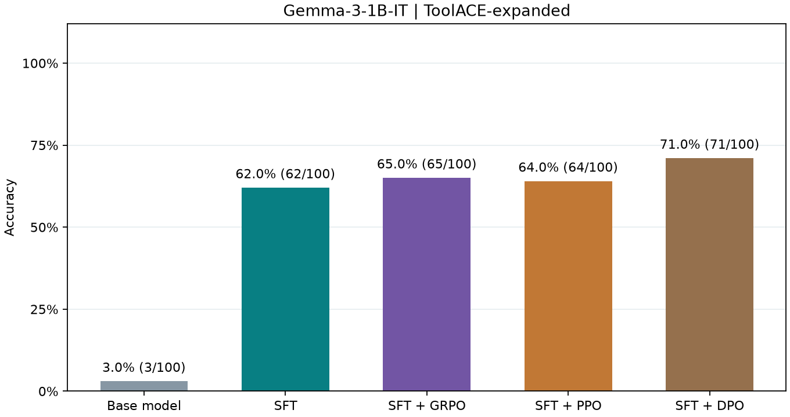
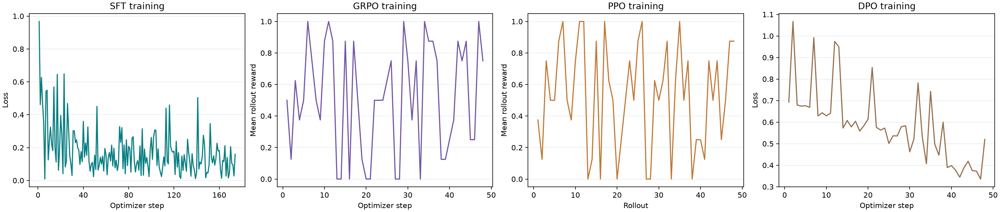

# Expanded ToolACE results

[中文](README.md) · English

[Interactive predictions](report.html)

[Split manifest](../../Datasets/ToolACE/manifest.json) · [694 training](../../Datasets/ToolACE/train.jsonl) · [100 validation](../../Datasets/ToolACE/val.jsonl) · [250 held-out test](../../Datasets/ToolACE/test_final.jsonl)

Evaluated on an RTX 5080 on November 18, 2026. Each item generates one JSON tool call, scored by exact match on the tool name and argument values and types. Target tool names from the test set are excluded from the training and validation candidates.

## Held-out test

| Model | Base model | SFT | SFT → GRPO | SFT → PPO | SFT → DPO |
| :--- | ---: | ---: | ---: | ---: | ---: |
| Qwen3-0.6B | 115/250 (46.0%) | 169/250 (67.6%) | 171/250 (68.4%) | 172/250 (68.8%) | 175/250 (70.0%) |
| DeepSeek-R1-1.5B | 0/250 (0.0%) | 139/250 (55.6%) | 137/250 (54.8%) | 137/250 (54.8%) | 143/250 (57.2%) |
| Gemma-3-1B-IT | 6/250 (2.4%) | 98/250 (39.2%) | 98/250 (39.2%) | 100/250 (40.0%) | 109/250 (43.6%) |

## DPO compared with SFT

| Model | Incorrect to correct | Correct to incorrect | Net additional passes |
| :--- | ---: | ---: | ---: |
| Qwen3-0.6B | 8 | 2 | +6 |
| DeepSeek-R1-1.5B | 7 | 3 | +4 |
| Gemma-3-1B-IT | 13 | 2 | +11 |

## Validation and training plots

| Model | Validation pass rate | Learning curves |
| :--- | :---: | :---: |
| Qwen3-0.6B |  |  |
| DeepSeek-R1-1.5B |  |  |
| Gemma-3-1B-IT |  |  |

## Setup

SFT ran for 174 steps. GRPO and PPO each ran 48 rollout rounds, and DPO ran 48 steps. The three branches used the same SFT adapter. Training seed 42 and evaluation batch size 16.

[Six paired examples](report.html#toolace-dpo-cases) show the prompts, reference calls, and model outputs.

Paired comparisons, error counts, and raw predictions

### Qwen compared with each model

Cells show the gap in percentage points, its 95% paired interval, and Qwen-only / opponent-only passes.

| Stage | DeepSeek-R1-1.5B | Gemma-3-1B-IT |
| :--- | :--- | :--- |
| Base | +46.0 [+40.0, +52.0] · 115/0 | +43.6 [+37.2, +50.0] · 113/4 |
| SFT | +12.0 [+6.0, +18.0] · 45/15 | +28.4 [+21.2, +35.2] · 84/13 |
| GRPO | +13.6 [+7.6, +19.6] · 49/15 | +29.2 [+22.0, +36.0] · 85/12 |
| PPO | +14.0 [+8.4, +19.6] · 47/12 | +28.8 [+22.0, +35.6] · 82/10 |
| DPO | +12.8 [+7.2, +18.4] · 45/13 | +26.4 [+19.6, +33.2] · 79/13 |

### Post-training compared with SFT

Cells show the change in percentage points and its 95% paired interval. Intervals reflect resampling of test items.

| Model | GRPO | PPO | DPO |
| :--- | :--- | :--- | :--- |
| Qwen3-0.6B | +0.8 [-1.2, +3.2] | +1.2 [-0.8, +3.2] | +2.4 [+0.0, +4.8] |
| DeepSeek-R1-1.5B | -0.8 [-2.0, +0.0] | -0.8 [-2.0, +0.0] | +1.6 [-0.8, +4.0] |
| Gemma-3-1B-IT | +0.0 [-1.6, +1.6] | +0.8 [-1.2, +3.2] | +4.4 [+1.6, +7.6] |

### Held-out errors

The stage links open the metrics, including the test-set and adapter hashes. Each stage's run_summary.json records the training configuration.

| Model | Stage | Invalid JSON | Bad schema | Wrong tool | Wrong arguments | Predictions |
| :--- | :--- | :--- | :--- | :--- | :--- | :--- |
| Qwen3-0.6B | [Base](Qwen3-0.6B/LLM/eval_final/metrics.json) | 71 | 3 | 9 | 52 | [Val](Qwen3-0.6B/LLM/eval/predictions.jsonl) · [Test](Qwen3-0.6B/LLM/eval_final/predictions.jsonl) |
| Qwen3-0.6B | [SFT](Qwen3-0.6B/SFT/eval_final/metrics.json) | 5 | 0 | 9 | 67 | [Val](Qwen3-0.6B/SFT/eval/predictions.jsonl) · [Test](Qwen3-0.6B/SFT/eval_final/predictions.jsonl) |
| Qwen3-0.6B | [GRPO](Qwen3-0.6B/GRPO/eval_final/metrics.json) | 6 | 0 | 8 | 65 | [Val](Qwen3-0.6B/GRPO/eval/predictions.jsonl) · [Test](Qwen3-0.6B/GRPO/eval_final/predictions.jsonl) |
| Qwen3-0.6B | [PPO](Qwen3-0.6B/PPO/eval_final/metrics.json) | 6 | 0 | 9 | 63 | [Val](Qwen3-0.6B/PPO/eval/predictions.jsonl) · [Test](Qwen3-0.6B/PPO/eval_final/predictions.jsonl) |
| Qwen3-0.6B | [DPO](Qwen3-0.6B/DPO/eval_final/metrics.json) | 5 | 0 | 8 | 62 | [Val](Qwen3-0.6B/DPO/eval/predictions.jsonl) · [Test](Qwen3-0.6B/DPO/eval_final/predictions.jsonl) |
| DeepSeek-R1-1.5B | [Base](DeepSeek-R1-1.5B/LLM/eval_final/metrics.json) | 250 | 0 | 0 | 0 | [Val](DeepSeek-R1-1.5B/LLM/eval/predictions.jsonl) · [Test](DeepSeek-R1-1.5B/LLM/eval_final/predictions.jsonl) |
| DeepSeek-R1-1.5B | [SFT](DeepSeek-R1-1.5B/SFT/eval_final/metrics.json) | 18 | 2 | 15 | 76 | [Val](DeepSeek-R1-1.5B/SFT/eval/predictions.jsonl) · [Test](DeepSeek-R1-1.5B/SFT/eval_final/predictions.jsonl) |
| DeepSeek-R1-1.5B | [GRPO](DeepSeek-R1-1.5B/GRPO/eval_final/metrics.json) | 21 | 1 | 15 | 76 | [Val](DeepSeek-R1-1.5B/GRPO/eval/predictions.jsonl) · [Test](DeepSeek-R1-1.5B/GRPO/eval_final/predictions.jsonl) |
| DeepSeek-R1-1.5B | [PPO](DeepSeek-R1-1.5B/PPO/eval_final/metrics.json) | 21 | 1 | 15 | 76 | [Val](DeepSeek-R1-1.5B/PPO/eval/predictions.jsonl) · [Test](DeepSeek-R1-1.5B/PPO/eval_final/predictions.jsonl) |
| DeepSeek-R1-1.5B | [DPO](DeepSeek-R1-1.5B/DPO/eval_final/metrics.json) | 19 | 1 | 12 | 75 | [Val](DeepSeek-R1-1.5B/DPO/eval/predictions.jsonl) · [Test](DeepSeek-R1-1.5B/DPO/eval_final/predictions.jsonl) |
| Gemma-3-1B-IT | [Base](Gemma-3-1B-IT/LLM/eval_final/metrics.json) | 228 | 7 | 1 | 8 | [Val](Gemma-3-1B-IT/LLM/eval/predictions.jsonl) · [Test](Gemma-3-1B-IT/LLM/eval_final/predictions.jsonl) |
| Gemma-3-1B-IT | [SFT](Gemma-3-1B-IT/SFT/eval_final/metrics.json) | 67 | 1 | 16 | 68 | [Val](Gemma-3-1B-IT/SFT/eval/predictions.jsonl) · [Test](Gemma-3-1B-IT/SFT/eval_final/predictions.jsonl) |
| Gemma-3-1B-IT | [GRPO](Gemma-3-1B-IT/GRPO/eval_final/metrics.json) | 67 | 1 | 16 | 68 | [Val](Gemma-3-1B-IT/GRPO/eval/predictions.jsonl) · [Test](Gemma-3-1B-IT/GRPO/eval_final/predictions.jsonl) |
| Gemma-3-1B-IT | [PPO](Gemma-3-1B-IT/PPO/eval_final/metrics.json) | 68 | 2 | 16 | 64 | [Val](Gemma-3-1B-IT/PPO/eval/predictions.jsonl) · [Test](Gemma-3-1B-IT/PPO/eval_final/predictions.jsonl) |
| Gemma-3-1B-IT | [DPO](Gemma-3-1B-IT/DPO/eval_final/metrics.json) | 67 | 1 | 14 | 59 | [Val](Gemma-3-1B-IT/DPO/eval/predictions.jsonl) · [Test](Gemma-3-1B-IT/DPO/eval_final/predictions.jsonl) |

