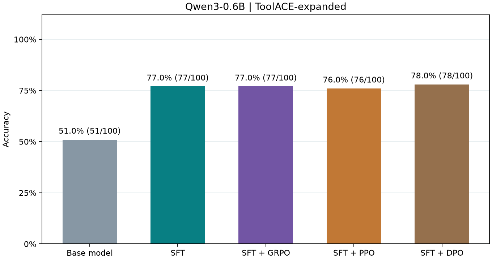
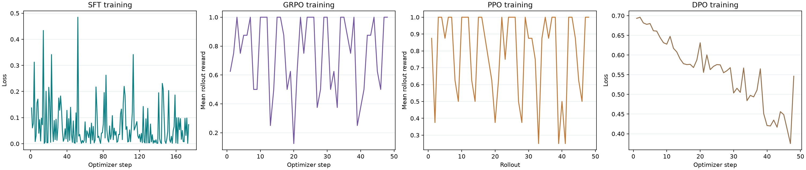
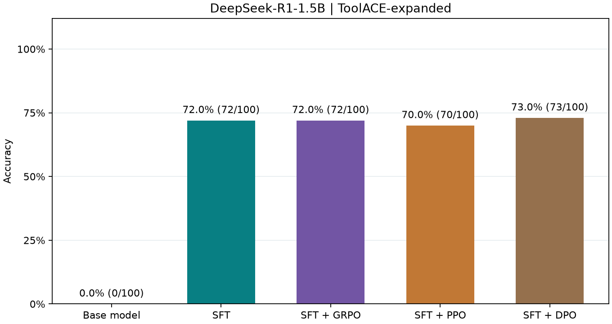
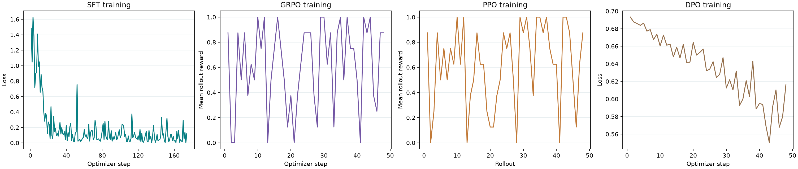
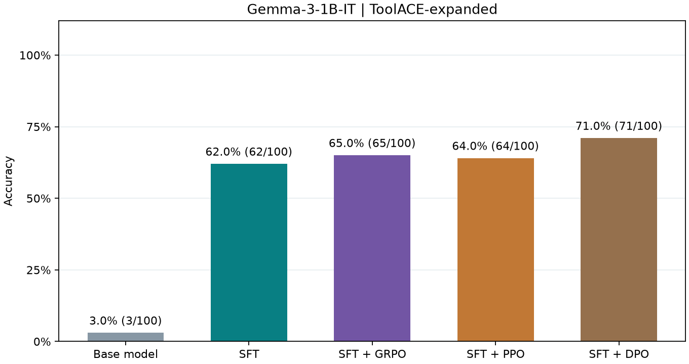
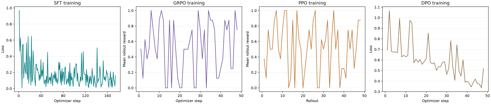

# ToolACE 扩容评估结果

中文 · [English](README.en.md)

[交互答卷](report.html)

[数据划分](../../Datasets/ToolACE/manifest.json) · [训练 694 题](../../Datasets/ToolACE/train.jsonl) · [验证 100 题](../../Datasets/ToolACE/val.jsonl) · [留出测试 250 题](../../Datasets/ToolACE/test_final.jsonl)

2026-11-18 在 RTX 5080 上评估。每题生成一次 JSON 工具调用，按工具名、参数值和类型精确匹配。测试目标工具名从训练和验证的候选工具中移除。

## 留出测试

| 模型 | 基座 | SFT | SFT → GRPO | SFT → PPO | SFT → DPO |
| :--- | ---: | ---: | ---: | ---: | ---: |
| Qwen3-0.6B | 115/250 (46.0%) | 169/250 (67.6%) | 171/250 (68.4%) | 172/250 (68.8%) | 175/250 (70.0%) |
| DeepSeek-R1-1.5B | 0/250 (0.0%) | 139/250 (55.6%) | 137/250 (54.8%) | 137/250 (54.8%) | 143/250 (57.2%) |
| Gemma-3-1B-IT | 6/250 (2.4%) | 98/250 (39.2%) | 98/250 (39.2%) | 100/250 (40.0%) | 109/250 (43.6%) |

## DPO 相对 SFT

| 模型 | 由错变对 | 由对变错 | 净增题数 |
| :--- | ---: | ---: | ---: |
| Qwen3-0.6B | 8 | 2 | +6 |
| DeepSeek-R1-1.5B | 7 | 3 | +4 |
| Gemma-3-1B-IT | 13 | 2 | +11 |

## 验证与训练图表

| 模型 | 验证集通过率 | 训练曲线 |
| :--- | :---: | :---: |
| Qwen3-0.6B |  |  |
| DeepSeek-R1-1.5B |  |  |
| Gemma-3-1B-IT |  |  |

## 实验设置

SFT 更新 174 步，GRPO 和 PPO 各采样 48 轮，DPO 更新 48 步。三个后训练分支共用同一份 SFT 权重。训练种子为 42，评估批量为 16。

[六道对照案例](report.html#toolace-dpo-cases)含原题、标准调用和模型原始输出。

配对分差、错误数与原始答卷

### 千问与其他模型对照

每格依次为分差（百分点）、95% 配对区间、千问独对题数 / 对手独对题数。

| 阶段 | DeepSeek-R1-1.5B | Gemma-3-1B-IT |
| :--- | :--- | :--- |
| 基座 | +46.0 [+40.0, +52.0] · 115/0 | +43.6 [+37.2, +50.0] · 113/4 |
| SFT | +12.0 [+6.0, +18.0] · 45/15 | +28.4 [+21.2, +35.2] · 84/13 |
| GRPO | +13.6 [+7.6, +19.6] · 49/15 | +29.2 [+22.0, +36.0] · 85/12 |
| PPO | +14.0 [+8.4, +19.6] · 47/12 | +28.8 [+22.0, +35.6] · 82/10 |
| DPO | +12.8 [+7.2, +18.4] · 45/13 | +26.4 [+19.6, +33.2] · 79/13 |

### 后训练相对 SFT

每格为分差（百分点）及 95% 配对区间，区间反映测试题的抽样波动。

| 模型 | GRPO | PPO | DPO |
| :--- | :--- | :--- | :--- |
| Qwen3-0.6B | +0.8 [-1.2, +3.2] | +1.2 [-0.8, +3.2] | +2.4 [+0.0, +4.8] |
| DeepSeek-R1-1.5B | -0.8 [-2.0, +0.0] | -0.8 [-2.0, +0.0] | +1.6 [-0.8, +4.0] |
| Gemma-3-1B-IT | +0.0 [-1.6, +1.6] | +0.8 [-1.2, +3.2] | +4.4 [+1.6, +7.6] |

### 留出题错误数

点击阶段可查评估指标及数据、权重哈希。各阶段的 run_summary.json 记录训练配置。

| 模型 | 阶段 | JSON 解析失败 | 结构错误 | 选错工具 | 参数不匹配 | 原始答卷 |
| :--- | :--- | :--- | :--- | :--- | :--- | :--- |
| Qwen3-0.6B | [基座](Qwen3-0.6B/LLM/eval_final/metrics.json) | 71 | 3 | 9 | 52 | [验证](Qwen3-0.6B/LLM/eval/predictions.jsonl) · [测试](Qwen3-0.6B/LLM/eval_final/predictions.jsonl) |
| Qwen3-0.6B | [SFT](Qwen3-0.6B/SFT/eval_final/metrics.json) | 5 | 0 | 9 | 67 | [验证](Qwen3-0.6B/SFT/eval/predictions.jsonl) · [测试](Qwen3-0.6B/SFT/eval_final/predictions.jsonl) |
| Qwen3-0.6B | [GRPO](Qwen3-0.6B/GRPO/eval_final/metrics.json) | 6 | 0 | 8 | 65 | [验证](Qwen3-0.6B/GRPO/eval/predictions.jsonl) · [测试](Qwen3-0.6B/GRPO/eval_final/predictions.jsonl) |
| Qwen3-0.6B | [PPO](Qwen3-0.6B/PPO/eval_final/metrics.json) | 6 | 0 | 9 | 63 | [验证](Qwen3-0.6B/PPO/eval/predictions.jsonl) · [测试](Qwen3-0.6B/PPO/eval_final/predictions.jsonl) |
| Qwen3-0.6B | [DPO](Qwen3-0.6B/DPO/eval_final/metrics.json) | 5 | 0 | 8 | 62 | [验证](Qwen3-0.6B/DPO/eval/predictions.jsonl) · [测试](Qwen3-0.6B/DPO/eval_final/predictions.jsonl) |
| DeepSeek-R1-1.5B | [基座](DeepSeek-R1-1.5B/LLM/eval_final/metrics.json) | 250 | 0 | 0 | 0 | [验证](DeepSeek-R1-1.5B/LLM/eval/predictions.jsonl) · [测试](DeepSeek-R1-1.5B/LLM/eval_final/predictions.jsonl) |
| DeepSeek-R1-1.5B | [SFT](DeepSeek-R1-1.5B/SFT/eval_final/metrics.json) | 18 | 2 | 15 | 76 | [验证](DeepSeek-R1-1.5B/SFT/eval/predictions.jsonl) · [测试](DeepSeek-R1-1.5B/SFT/eval_final/predictions.jsonl) |
| DeepSeek-R1-1.5B | [GRPO](DeepSeek-R1-1.5B/GRPO/eval_final/metrics.json) | 21 | 1 | 15 | 76 | [验证](DeepSeek-R1-1.5B/GRPO/eval/predictions.jsonl) · [测试](DeepSeek-R1-1.5B/GRPO/eval_final/predictions.jsonl) |
| DeepSeek-R1-1.5B | [PPO](DeepSeek-R1-1.5B/PPO/eval_final/metrics.json) | 21 | 1 | 15 | 76 | [验证](DeepSeek-R1-1.5B/PPO/eval/predictions.jsonl) · [测试](DeepSeek-R1-1.5B/PPO/eval_final/predictions.jsonl) |
| DeepSeek-R1-1.5B | [DPO](DeepSeek-R1-1.5B/DPO/eval_final/metrics.json) | 19 | 1 | 12 | 75 | [验证](DeepSeek-R1-1.5B/DPO/eval/predictions.jsonl) · [测试](DeepSeek-R1-1.5B/DPO/eval_final/predictions.jsonl) |
| Gemma-3-1B-IT | [基座](Gemma-3-1B-IT/LLM/eval_final/metrics.json) | 228 | 7 | 1 | 8 | [验证](Gemma-3-1B-IT/LLM/eval/predictions.jsonl) · [测试](Gemma-3-1B-IT/LLM/eval_final/predictions.jsonl) |
| Gemma-3-1B-IT | [SFT](Gemma-3-1B-IT/SFT/eval_final/metrics.json) | 67 | 1 | 16 | 68 | [验证](Gemma-3-1B-IT/SFT/eval/predictions.jsonl) · [测试](Gemma-3-1B-IT/SFT/eval_final/predictions.jsonl) |
| Gemma-3-1B-IT | [GRPO](Gemma-3-1B-IT/GRPO/eval_final/metrics.json) | 67 | 1 | 16 | 68 | [验证](Gemma-3-1B-IT/GRPO/eval/predictions.jsonl) · [测试](Gemma-3-1B-IT/GRPO/eval_final/predictions.jsonl) |
| Gemma-3-1B-IT | [PPO](Gemma-3-1B-IT/PPO/eval_final/metrics.json) | 68 | 2 | 16 | 64 | [验证](Gemma-3-1B-IT/PPO/eval/predictions.jsonl) · [测试](Gemma-3-1B-IT/PPO/eval_final/predictions.jsonl) |
| Gemma-3-1B-IT | [DPO](Gemma-3-1B-IT/DPO/eval_final/metrics.json) | 67 | 1 | 14 | 59 | [验证](Gemma-3-1B-IT/DPO/eval/predictions.jsonl) · [测试](Gemma-3-1B-IT/DPO/eval_final/predictions.jsonl) |

