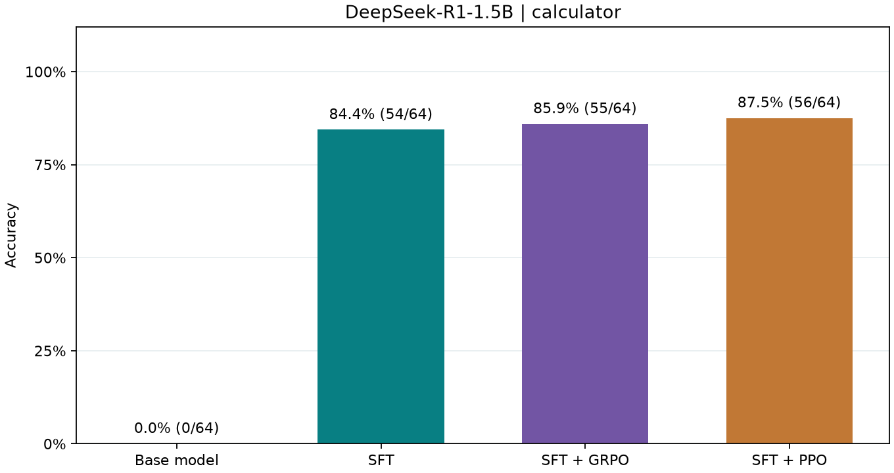
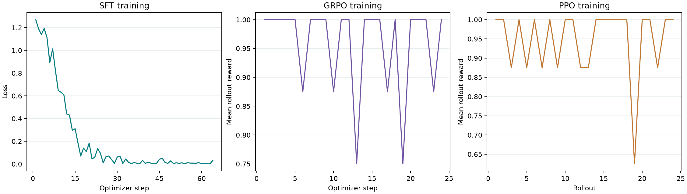
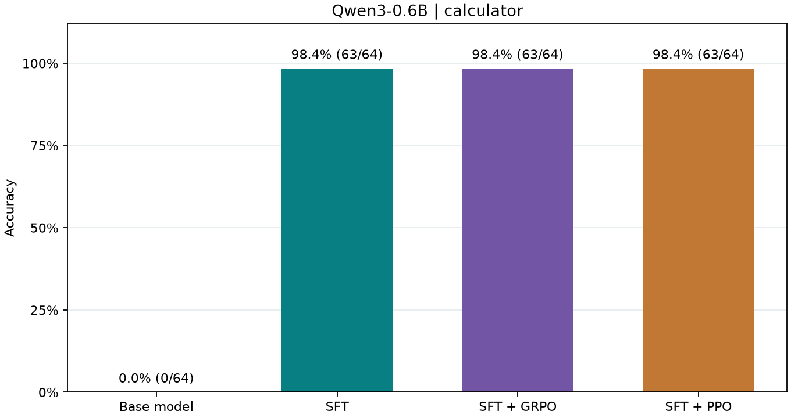
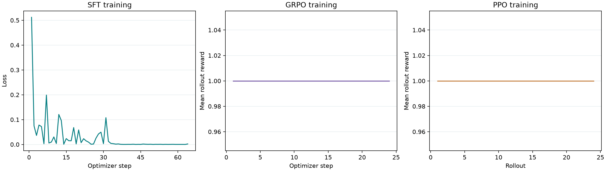

# calculator evaluation results

[中文](README.md) · English

Validation set, 64 questions

| Model | Method | Correct / Total | Success rate |
| :--- | :--- | :--- | :--- |
| DeepSeek-R1-1.5B | Base model | 0 / 64 | 0.00% |
| DeepSeek-R1-1.5B | SFT | 54 / 64 | 84.38% |
| DeepSeek-R1-1.5B | SFT + GRPO | 55 / 64 | 85.94% |
| DeepSeek-R1-1.5B | SFT + PPO | 56 / 64 | 87.50% |
| Qwen3-0.6B | Base model | 0 / 64 | 0.00% |
| Qwen3-0.6B | SFT | 63 / 64 | 98.44% |
| Qwen3-0.6B | SFT + GRPO | 63 / 64 | 98.44% |
| Qwen3-0.6B | SFT + PPO | 63 / 64 | 98.44% |

 

## Paired comparison with SFT

| Model | Method | Change in success rate (pp) | 95% confidence interval (pp) |
| :--- | :--- | :---: | :---: |
| DeepSeek-R1-1.5B | GRPO | +1.56 | [+0.00, +4.69] |
| DeepSeek-R1-1.5B | PPO | +3.12 | [+0.00, +7.81] |
| Qwen3-0.6B | GRPO | +0.00 | [+0.00, +0.00] |
| Qwen3-0.6B | PPO | +0.00 | [+0.00, +0.00] |

 

## Success rates and training curves

| Model | Validation success rate | Training curves |
| :--- | :---: | :---: |
| DeepSeek-R1-1.5B |  |  |
| Qwen3-0.6B |  |  |

<!-- END GENERATED RESULTS -->

 

## Findings

- **SFT gap** Qwen answered nine more questions correctly. On those nine, DeepSeek had five JSON parsing errors, one unsupported operation name, and three incorrect operands. [Scoring rules](../../Datasets/calculator/task.py)
- **Effect of RL** Starting from the same SFT weights, DeepSeek with GRPO fixed one answer and with PPO fixed two. These were operand sign errors. Both runs still had five JSON parsing errors and two tool schema errors.
- **Base models** Both models answered the same 64 validation questions using their own chat templates. The DeepSeek base model reached the 128-token generation limit on 60 questions, often spending that budget on explanations. The verifier scores the submitted tool call.

 

## Raw answers to the same questions

| Question | Raw answers | What went wrong |
| :--- | :--- | :--- |
| Subtract Ginkgo (10) from Cedar (-15) `val-ca2ab740e96f7cf7` | DeepSeek SFT `{"tool":"calculate","op":"subtract","args":[−15,10]}` Qwen SFT `{"tool":"calculate","op":"subtract","args":[-15,10]}` | DeepSeek used the mathematical minus sign `−`. Negative JSON numbers require the ASCII hyphen-minus `-`. |
| Multiply Fir (18) by Dahlia (-39) `val-813cf81e4633b82e` | DeepSeek SFT `{"tool":"calculate","op":"product","args":[18,-39]}` Qwen SFT `{"tool":"calculate","op":"multiply","args":[18,-39]}` | The tool expects `multiply`. It rejects DeepSeek’s operation name, `product`. |
| Multiply Birch (46) by Aster (2) `val-5521a084ba23897e` | DeepSeek SFT `{"tool":"calculate","op":"multiply","args":[46,-28]}` Qwen SFT `{"tool":"calculate","op":"multiply","args":[46,2]}` | DeepSeek picked Ginkgo’s `-28` and got `-1288`. The expected result was `92`. |
| 84 − (-38) `val-7d3069ed88123ad5` | DeepSeek SFT `{"tool":"calculate","op":"subtract","args":[-84,-38]}` Qwen SFT and DeepSeek PPO `{"tool":"calculate","op":"subtract","args":[84,-38]}` | DeepSeek SFT passed `-84` and got `-46`. PPO corrected the sign, giving `122`. |
| Add 88 and -29 from the Fir row `val-a36c869f0e0cddbe` | Both SFT models `{"tool":"calculate","op":"sum","args":[88,-29]}` | Both used `sum` for `op`. The tool expects `add`. |

Raw base-model answers · 55 + (-5) · val-6e6bdfe91293863e

DeepSeek reached the token limit while still explaining the task. Qwen put `add` in `tool` and omitted the `op` field.

**DeepSeek-R1-1.5B**

~~~text
Okay, so the user is asking me to guide them on how to perform the addition of 55 and -5 using a calculator tool. The specific requirements are that I need to return a JSON object in the format {"tool":"calculate","op":"add","args":[integer,integer]}. The task is to use the original operands, not the computed answer, and the operand order as specified, which is 55 add -5.

First, I need to figure out what each part of the JSON structure represents. The "tool" should obviously be "calculate" since we're talking about a calculator. The "op"
~~~

**Qwen3-0.6B**

~~~text
{"tool":"add","args":[55,-5]}
~~~

 

## Question-level records

| Model | Base model | SFT | GRPO | PPO |
| :--- | :---: | :---: | :---: | :---: |
| DeepSeek-R1-1.5B | [Raw answers](DeepSeek-R1-1.5B/Comparison/predictions/LLM.jsonl) | [Raw answers](DeepSeek-R1-1.5B/Comparison/predictions/SFT.jsonl) | [Raw answers](DeepSeek-R1-1.5B/Comparison/predictions/GRPO.jsonl) | [Raw answers](DeepSeek-R1-1.5B/Comparison/predictions/PPO.jsonl) |
| Qwen3-0.6B | [Raw answers](Qwen3-0.6B/Comparison/predictions/LLM.jsonl) | [Raw answers](Qwen3-0.6B/Comparison/predictions/SFT.jsonl) | [Raw answers](Qwen3-0.6B/Comparison/predictions/GRPO.jsonl) | [Raw answers](Qwen3-0.6B/Comparison/predictions/PPO.jsonl) |
