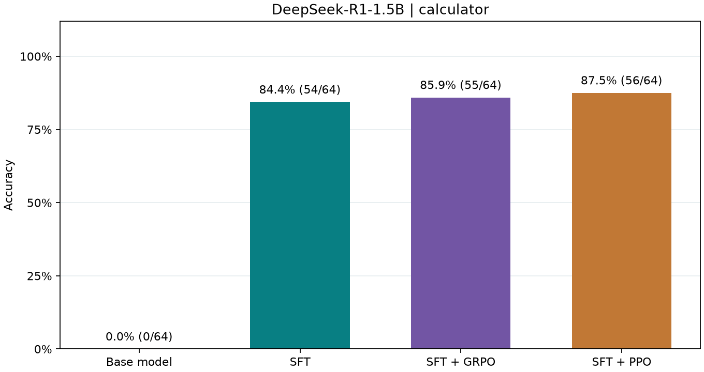
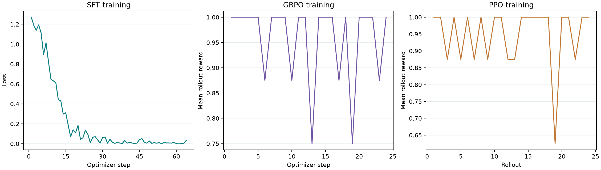
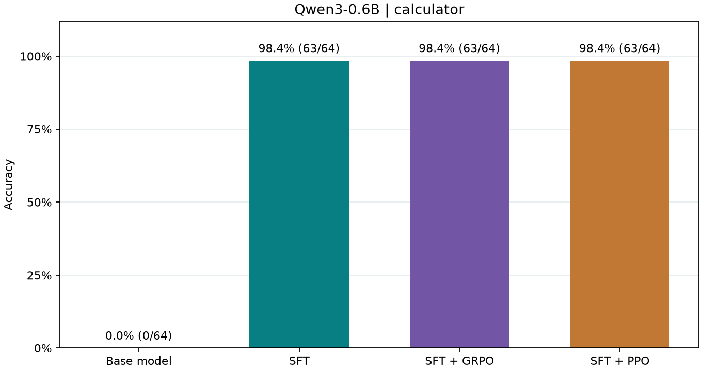
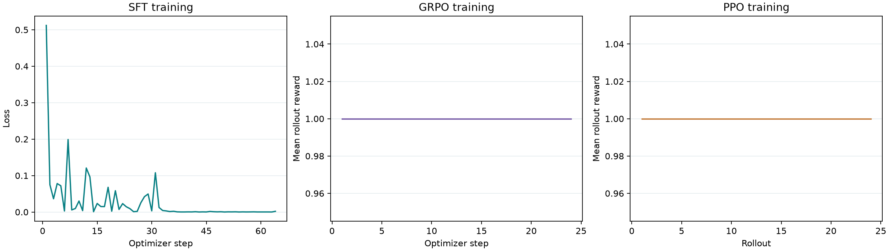

# calculator 评估结果

中文 · [English](README.en.md)

验证集，共 64 题

| 模型 | 方法 | 正确 / 总数 | 成功率 |
| :--- | :--- | :--- | :--- |
| DeepSeek-R1-1.5B | Base model | 0 / 64 | 0.00% |
| DeepSeek-R1-1.5B | SFT | 54 / 64 | 84.38% |
| DeepSeek-R1-1.5B | SFT + GRPO | 55 / 64 | 85.94% |
| DeepSeek-R1-1.5B | SFT + PPO | 56 / 64 | 87.50% |
| Qwen3-0.6B | Base model | 0 / 64 | 0.00% |
| Qwen3-0.6B | SFT | 63 / 64 | 98.44% |
| Qwen3-0.6B | SFT + GRPO | 63 / 64 | 98.44% |
| Qwen3-0.6B | SFT + PPO | 63 / 64 | 98.44% |

 

## 与 SFT 的配对比较

| 模型 | 方法 | 成功率变化（百分点） | 95% 置信区间（百分点） |
| :--- | :--- | :---: | :---: |
| DeepSeek-R1-1.5B | GRPO | +1.56 | [+0.00, +4.69] |
| DeepSeek-R1-1.5B | PPO | +3.12 | [+0.00, +7.81] |
| Qwen3-0.6B | GRPO | +0.00 | [+0.00, +0.00] |
| Qwen3-0.6B | PPO | +0.00 | [+0.00, +0.00] |

 

## 成功率与训练曲线

| 模型 | 验证集成功率 | 训练曲线 |
| :--- | :---: | :---: |
| DeepSeek-R1-1.5B |  |  |
| Qwen3-0.6B |  |  |

<!-- END GENERATED RESULTS -->

 

## 结果解读

- **SFT 分差** 千问多答对 9 题。DeepSeek 在这 9 题里有 5 题 JSON 解析失败、1 题运算名不符、3 题操作数错误。[评分规则](../../Datasets/calculator/task.py)
- **RL 的变化** 从同一份 SFT 权重续训后，DeepSeek 的 GRPO 和 PPO 分别修好 1 题和 2 题，改对的是操作数的正负号。两种方法都还剩 5 题 JSON 错和 2 题接口错。
- **基座表现** 同样的 64 道验证题，两款模型用了各自的聊天模板。DeepSeek 基座有 60 题用满 128 个生成 token，常把生成预算花在解释上。分数按实际提交的工具调用判定。

 

## 同题原始回答

| 题目 | 原始回答 | 错在哪 |
| :--- | :--- | :--- |
| Cedar 的 -15 减 Ginkgo 的 10 `val-ca2ab740e96f7cf7` | DeepSeek SFT `{"tool":"calculate","op":"subtract","args":[−15,10]}` 千问 SFT `{"tool":"calculate","op":"subtract","args":[-15,10]}` | DeepSeek 用了数学减号 `−`。JSON 数字只接受 ASCII 负号 `-`。 |
| Fir 的 18 乘 Dahlia 的 -39 `val-813cf81e4633b82e` | DeepSeek SFT `{"tool":"calculate","op":"product","args":[18,-39]}` 千问 SFT `{"tool":"calculate","op":"multiply","args":[18,-39]}` | 接口规定乘法叫 `multiply`。DeepSeek 的 `product` 无法执行。 |
| Birch 的 46 乘 Aster 的 2 `val-5521a084ba23897e` | DeepSeek SFT `{"tool":"calculate","op":"multiply","args":[46,-28]}` 千问 SFT `{"tool":"calculate","op":"multiply","args":[46,2]}` | DeepSeek 取了 Ginkgo 的 `-28`，算出 `-1288`，应为 `92`。 |
| 84 − (-38) `val-7d3069ed88123ad5` | DeepSeek SFT `{"tool":"calculate","op":"subtract","args":[-84,-38]}` 千问 SFT、DeepSeek PPO `{"tool":"calculate","op":"subtract","args":[84,-38]}` | DeepSeek SFT 把 `84` 写成 `-84`，算出 `-46`。PPO 修正后结果为 `122`。 |
| Fir 行的 88 加 -29 `val-a36c869f0e0cddbe` | 两款 SFT `{"tool":"calculate","op":"sum","args":[88,-29]}` | 两款都把 `sum` 填进了 `op`，接口要求 `add`。 |

基座原始回答 · 55 + (-5) · val-6e6bdfe91293863e

DeepSeek 生成到上限仍在解释。千问把 `add` 写进了 `tool`，缺少单独的 `op`。

**DeepSeek-R1-1.5B**

~~~text
Okay, so the user is asking me to guide them on how to perform the addition of 55 and -5 using a calculator tool. The specific requirements are that I need to return a JSON object in the format {"tool":"calculate","op":"add","args":[integer,integer]}. The task is to use the original operands, not the computed answer, and the operand order as specified, which is 55 add -5.

First, I need to figure out what each part of the JSON structure represents. The "tool" should obviously be "calculate" since we're talking about a calculator. The "op"
~~~

**Qwen3-0.6B**

~~~text
{"tool":"add","args":[55,-5]}
~~~

 

## 逐题记录

| 模型 | 基座 | SFT | GRPO | PPO |
| :--- | :---: | :---: | :---: | :---: |
| DeepSeek-R1-1.5B | [原始回答](DeepSeek-R1-1.5B/Comparison/predictions/LLM.jsonl) | [原始回答](DeepSeek-R1-1.5B/Comparison/predictions/SFT.jsonl) | [原始回答](DeepSeek-R1-1.5B/Comparison/predictions/GRPO.jsonl) | [原始回答](DeepSeek-R1-1.5B/Comparison/predictions/PPO.jsonl) |
| Qwen3-0.6B | [原始回答](Qwen3-0.6B/Comparison/predictions/LLM.jsonl) | [原始回答](Qwen3-0.6B/Comparison/predictions/SFT.jsonl) | [原始回答](Qwen3-0.6B/Comparison/predictions/GRPO.jsonl) | [原始回答](Qwen3-0.6B/Comparison/predictions/PPO.jsonl) |
